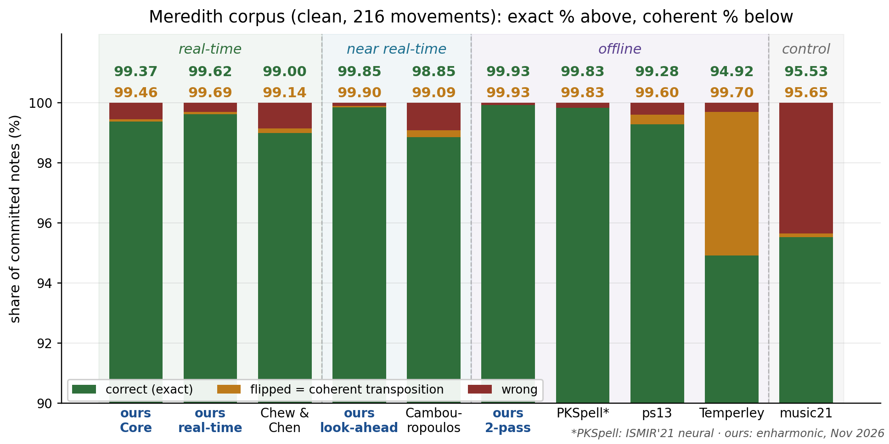

# enharmonic

[](https://doi.org/10.5281/zenodo.23023002)

**Real-time enharmonic pitch-spelling for MIDI input.**

Given a stream of MIDI note numbers, decides whether `61` should be spelled `C♯` or `D♭`
from musical context. Zero runtime dependencies. ESM / TypeScript. Apache-2.0.

```bash
npm install enharmonic
```

## Quickstart

```ts
import { Speller, spellTwoPass, lookAheadContext } from 'enharmonic';

// Real-time (zero look-ahead)
const s = new Speller();
s.noteOn(60, { t: 0 });
s.noteOn(64, { t: 0 });
s.noteOn(67, { t: 0 });
console.log(s.getSpelling(64)); // { step: 'E', alter: 0, octave: 4 }
s.noteOff(60, { t: 500 }); s.noteOff(64, { t: 500 }); s.noteOff(67, { t: 500 });

// Near-real-time: each note's context is read from the notes around it
const notes = [{ midi: 61, tOn: 0, tOff: 500 }, { midi: 62, tOn: 500, tOff: 1000 }];
const ctx = lookAheadContext(notes);
const nrt = new Speller({ lookAhead: true });
notes.forEach((n, i) => nrt.noteOn(n.midi, { ...ctx[i], t: n.tOn })); // 61 resolves up to 62 → C♯, not D♭

// Offline ceiling (whole piece in hand)
const spelled = spellTwoPass([
  { midi: 60, tOn: 0, tOff: 500 },
  { midi: 64, tOn: 0, tOff: 500 },
]);
```

## API

| Call | Latency | Role |
|---|---|---|
| `new Speller()` | real-time | Recency guard + spiral fold + diatonic-anchor leash |
| `new Speller({ lookAhead: true })` | near-real-time | + letter-aware look-ahead (looks until the note resolves) + vertical guard + aug6 outward rule + leading-tone and key-degree gates + key → side + dominant tendency tones |
| `spellTwoPass(notes)` | offline | Forward + backward, reconciled at modulation boundaries, never inside a repeated run, never by a triangle-free sonority (aug6 rule and both key gates in both passes) |

Frameless and key-signature-free: in real time the side a passage settles on is a statistic of the notes
committed so far, never a detected key. (In look-ahead, a local key read from the notes around each note names
a falling leading tone, keeps a note's letter on a move into a chromatic pitch, and, as `sideKey`, re-centres
the side on the key's conventional signature; see below.)

### Timing

The speller is onset-based, not wall-clock-based. Each note's `t` groups co-struck notes: notes
sharing a `t` are one onset (a chord), and a new `t` starts a new onset. Omit `t` and every call is
its own onset, which is fine for a purely melodic stream.

```ts
s.noteOn(60, { t: 0 }); s.noteOn(64, { t: 0 }); s.noteOn(67, { t: 0 }); // one chord (same t)
s.noteOn(69, { t: 500 });                                               // next onset
```

For live input pass real timestamps; for batch replay pass an increasing `t` per onset.

Within an onset, notes arrive one by one (bass first in a score). When a later note of the same onset
arrives, the earlier ones are decided again with it sounding, so a bass can follow the chord above it.
A note's spelling can therefore change until its onset is complete.

Pass `t` to `noteOff` too. A chromatic note that ends within 80 ms of its onset (a grace note) does not
shape how later notes are spelled; without `t` every note counts.

### Look-ahead context

`lookAheadContext(notes)` reads every field below for `{ midi, tOn, tOff }` notes sorted by onset, one
`NoteContext` per note; pass each to `noteOn` with its `t`. The functions it calls are exported too, for a
caller who wants only some of the context.

`resolveDir` is the first semitone step from the note to an upcoming note in any octave (+1 up, −1 down,
0 none); `resolveExact` is the same at the exact pitch, the note's own line. `resolveStep` and
`resolveExactStep` compute each from a pair of midi numbers. The exact one lets a rising chromatic line
(B, B♯, C♯) through the recency guard.

`resolutionDirs(notes)` reads both for every note of `{ midi, tOn }` notes in onset order: the first semitone
step among the next 16 notes, and when that finds none, "look until the note resolves": it follows the note's
own voice (same octave; notes struck with it do not count, a re-strike extends the scan, a step of a tone does
not end it) until the voice moves by a semitone, up to 128 notes. Mozart Requiem Introitus m45: G♯ hammered
eight times across doubled parts rises to A 80 notes later; the 16-note buffer finds no semitone and the speller
wrote A♭, the own-voice scan writes G♯. The reach, `resolutionDirs(notes, { mode: 'own-voice', window: 16, max:
128, unit: 'notes' })` (the default, `RESOLUTION_REACH`), is a theory parameter, not a latency budget: about one
chromatic note in six resolves beyond 16 notes (doubled or repeated chords, hammered notes, a voice resting),
and following it pays up to about 128 notes. A live caller who wants the rule exactly must buffer that far;
`{ mode: 'window' }` keeps the 16-note buffer only. A far resolution on the same letter (E later falling to E♭)
is still read as a letter step, as within the buffer. Two-pass keeps its own 16-note reader.

`outwardPartner` and `outwardRole` name an augmented sixth by where its tones go: two tones ten semitones
apart that move outward onto one pitch class (A♭–C–E♭–F♯ → G) make the rising tone the ♯4, spelled F♯
against A♭, not G♭. `outwardPairs(notes)` finds the pairs from `{ midi, tOn, tOff }` notes sorted by onset;
the tones meet when one of the next 8 onsets strikes both goals, or when their first moves (re-strikes skipped)
land on one onset, so a German sixth repeated across a bar still pairs (`{ firstMoveMeet: false }` turns that
off; in `spellTwoPass`, `aug6FirstMoveMeet: false`). When both goals are one pitch (F♯ and A♭ onto one G), the
meeting onset must strike a chord of at least 3 notes (`{ chordMeet: 3 }`, the default; 0 turns it off): two lone
voices crossing on a note are passing. `spellTwoPass` keeps this off unless `aug6ChordMeet` is set. Pass each note's partner midi and role (+1 rising, −1 falling) when it has one. The engine applies the rule
only when the meeting pitch is in the key and the rising tone is not, so a dominant seventh whose diatonic
seventh rises chromatically (D→D♯ in E7) keeps its spelling. In look-ahead, a pair whose falling tone the rule
would write as a double flat of a pitch the frame names natural is a passing voice, and neither tone takes the
rule (engine option `aug6PassingVoice`). `spellTwoPass` does this itself (`aug6Outward: false` turns it off).

`localKey` names a leading tone of the local key (its ♯4 leading to the dominant; in minor also the raised
6th and 7th): a falling chromatic line from it cancels it, so C♯→C in D minor stays C♯ instead of the
look-ahead's letter step D♭→C. `localKeys(notes)` reads each note's key from `{ midi, tOn }` notes, on the
onsets from 12 before to 12 after the note's own, by correlation with a key table from theory (a key is its
tonic triad inside its seven-note collection: tonic-triad tones 3, other collection tones 2, the rest 0; no
fitted numbers); pass it as `localKey`. `spellTwoPass` reads the same key itself (`leadingToneGate: false` turns
it off). Temperley's profiles (*Music and Probability*, 2007) remain available as `{ table: 'temperley' }`.

`degreeKey` is the key-degree gate's key: a semitone resolution is a letter step only into a degree of the
local key (major: its seven degrees; minor: natural minor plus the raised 6th and 7th), and a move into a
chromatic pitch keeps the note's letter. In C major F rising to F♯ stays F (F♯ is not in the key); in A major
the same rise is E♯→F♯. `degreeKeys(notes)` reads it with the theory table on the 12 notes on each side of the
note (notes in onset order); pass it as `degreeKey`. `spellTwoPass` does this itself (`keyDegreeGate: false`
turns it off).

`sideKey` is key → side: a passage is notated on the side of its local key's conventional signature (D♭
major sounds, so D♭–F–A♭, not C♯–E♯–G♯). `sideKeys(notes)` reads it from `{ midi, tOn }` notes in onset order,
look-ahead legal: the key of the last 96 onsets plus the next 16 notes (a primary-triads table: tonic and fifth
4, third 3, other collection tones 2), taken only when the next 16 notes sound the new key's own notes more than
the old key's, and deepened along the spiral up to 7 accidentals. It returns the relative major's tonic on the
line of fifths (NaN for the F♯/G♭ tie); pass it as `sideKey` and the speller re-centres its fold there whenever
it changes (as `setKey`), seeding the frame on the first note. It moves whole passages to the composer's side
(fewer flips, higher exact); it does not lower the wrong count. Two-pass reads its own, offline key (below).

`dominant` is the rule "a dominant names its tendency tones": when a major triad or dominant seventh sounds and
the next chord with a different root has its root a fifth below, its third (the leading tone of the target) and
its seventh (the tone that falls to the target's third) take the spelling that makes them its third and seventh.
E7 → Am7: the G♯ is E7's third, even when it falls to G and the look-ahead would vote A♭ (Chopin Op. 28 No. 4
m4). The root and fifth are not renamed: the root is read from the spellings of the sounding root and fifth
(else from the frame), and the rule abstains when the name would lie more than the leash deadzone (8 fifths)
from the collection centre. It overrides every score except the aug6 outward rule. `dominantChords(notes)` reads
it from `{ midi, tOn, tOff }` notes; pass it as `dominant`. Two-pass does not use it.

The reach, `dominantChords(notes, { reach: 16, unit: 'onsets' })` (the default), is a theory parameter: how far
ahead the chord a fifth below may lie. It counts onsets, not notes, so it can look past the look-ahead's
16-note buffer. Measured from each named third or seventh to the first note of the chord that triggers it
(reach 16 onsets): median 5 notes, 95th percentile 30, maximum 146 on our 60-piece corpus (13% beyond 16
notes); median 5, 95th percentile 33, maximum 106 on Meredith clean (17% beyond 16); median 4, 95th
percentile 19, maximum 37 on Meredith noisy (8% beyond 16). From the dominant's onset the trigger is a median
of 2 onsets ahead (95th percentile 8–11). A live caller who wants the rule exactly must buffer that far, or
pass a smaller reach.

With `localKey`, the look-ahead also finds a rising leading tone's target when the note's own other spelling
holds the target's letter: F♯ rising to G while the G slot holds G♭ is still G's leading tone (the look-ahead votes F♯) when
the local key names F♯ a leading tone (in G major or E minor, not in D♭ major). Engine option
`heldLetterTarget`, on in both look-ahead and two-pass.

Two-pass reconciles its passes by "no triangle, no side boundary": a sonority with no major or minor triad in it
(a diminished seventh, an augmented triad, a bare dyad, any other triangle-free set of two or more pitch classes)
names its tones only relative to each other, so it cannot say where a passage changes side. Where the passes
disagree over a run made at least half of such notes, each pitch class takes the spelling the notes around the
run give it (32 notes each way; the rule abstains if the two sides disagree). WTC II m68: B♯, F♯, A♯, G♯ in
dyads and triangle-free three-note sets get Bach's sharps from the sharp context, where the backward pass wrote
C, G♭, B♭, A♭. Option `triangleFreeContext`, default on.

Two-pass reads the side from an offline local key: a passage is written on the side of its local key's
conventional signature, so both passes count accidentals from that signature, not from C. `centredSideKeys(notes)`
reads each note's key on the 48 onsets on each side of it (the `sideKeys` table and deepening, no confirmation
step) and returns the relative major's tonic on the line of fifths. A key with six or seven accidentals (the
F♯/G♭ tie, or a key deepened past five) is written either way and does not choose: the passes count from C there.
Debussy, *Clair de lune* m44–47 (D♭ major): the passes keep Debussy's G♭, D♭, E♭, A♭ where they wrote F♯, C♯, D♯,
G♯. Without the six-accidental limit Chopin's Sonata No. 2/ii (E♭ minor, six flats) would come out in D♯ minor.
Option `keySide`, default on.

The key reader deepens each new key along the spiral up to seven accidentals. A key written on the near side only
because its far reading is past that limit is a readability respell, so when the music returns to the key it came
from, that key keeps its prior side. A parallel, or the parallel of the relative, of the forced key or of the key
just before is never a return, and such a candidate disarms the pending return. Beethoven, *Pathétique* ii: A♭
minor (−7), then F♭ major (forced to E major, +4), then A♭ minor again at m47, read −7 instead of G♯ minor (+5), so
m48–52 come back to A♭ and C♭. The counter-case is a prior key that was itself over-deepened (D♭ already read as C♯
at +7): the return restores the over-rotation. Option `keyReturn`, default on (`centredSideKeys(notes, radius,
keyReturn)`).

A composer respells a passage for a section, never for a few beats. Where the passes disagree over a region of at
most 32 onsets holding at least three pitch classes, and the merge spells it against the notes just before and just
after it (32 notes each way, which agree with each other), the region takes, whole, the pass the surroundings use.
Handel, Op. 2 No. 9/iv m71–76: the merge wrote A♭ minor and D♭ minor (B𝄫, E𝄫) inside Handel's sharps; the rule
gives back his G♯ minor and C♯ minor (F𝄪, B♯, E♯). The cost is a composer's own short respell, which is undone too
(Chopin's *Barcarolle* m23–24). Option `shortFlip`, default on.

After the merge, two-pass lets a struck triad spell its third member: where the three pitch classes of a major or
minor triad are attacked together and two members are spelled coherently with each other, a member a comma off the
triad (a diminished fourth or augmented second inside it) takes the spelling that completes it, but only toward the
local centre of the merged spellings (the median of the 16 notes on each side), and not when it is a third that
moves a semitone onto the other third of the same root (an appoggiatura). Mozart K. 459/iii (F minor), A♭–C–F
struck together: the merge wrote G♯, the rule writes Mozart's A♭. A chromatic line tone inside a struck triad is
the counter-case: Joplin's C♯ rising to D against G♭–B♭ (*Chrysanthemum* m18) is respelt D♭. Option
`struckTriadThird`, default on.

### Optional key hint (experimental)

Keyless, the speller parks its spiral fold on the sharp side, so a genuinely flat piece can drift to its
sharp enharmonic (D♭ to C♯). Passing the key re-centres the fold and holds the notated side:

```ts
const s = new Speller({ keyTonic: -5 });   // D♭ major: signed line-of-fifths of the MAJOR tonic
s.setKey(2);                                // re-centre mid-stream at a key change (here, D major)
```

`keyTonic` is the signed line-of-fifths of the major tonic (C=0, G=+1, F=−1, D♭=−5; for a minor key pass
its relative major, A minor to C=0). Experimental; omit it for the default keyless behaviour above. In
look-ahead, the key read from the notes takes the supplied signature's side, past seven accidentals too when it is
within one fifth of the signature: under seven sharps (C♯ major) the dominant G♯ major keeps F𝄪, not A♭ major.

Keyless, the real-time speller writes a move to a collection that would need seven accidentals in its twin
with five or fewer: C♯ minor turning to its parallel major is spelled D♭ major (F, C natural), not C♯ major
(E♯, B♯), as Chopin does in Op. 28/15 m75. A supplied key turns it off (the signature names the side), and
look-ahead and two-pass do not use it. Engine option `frameTwin`, on in the real-time preset. Known cost: a
piece that reaches C♯ major by fifths from a sharp neighbourhood (Chopin's Barcarolle m81–106) is respelt flat.

In minor, the real-time and look-ahead spellers spell a chromatic note against the key's raised 7th, whether or
not it sounded recently: in C minor with only B♭ heard, G–?–G is spelled G–F♯–G (F♯ completes B–D–F♯), not G♭. The
minor is read from the two tonic triads on the recent pitch classes. Engine option `minorLeadingTone`, on in the
real-time and look-ahead presets, keyless and keyed; two-pass does not use it. Known cost: a chromatic note of a third key that the
collection and its relative minor do not name (Mozart's Confutatis m14, the vii°7 of D minor over a G-major
collection, writes A♯ for B♭).

In real time, a misspelled third inside a struck major or minor triad outweighs the lean toward the sharp spelling
of a chromatic note: after G major, a struck E♭–G–B♭ is spelled E♭ G B♭, not D♯ G A♯. The triad is read by pitch
class and must hold the note as its root, third or fifth, so a chromatic neighbour beside a triad is not taken for
its misspelled third (E♯ above a held B–D–F♯ stays E♯), nor is a note whose triad already sounds its other third
(G♯ against a ringing F–A–C). Engine options `verticalWeight: 2`, `verticalPcTriad` and `verticalOwnTriad`, with a
recency-guard window of 7 onsets, as in look-ahead; the real-time preset only. Known cost: a recency guard of 7
onsets can hold a spelling across a chord change (Chopin Op. 28/4 m3, E♭ written after the B7's D♯).

### Optional key signatures (two-pass)

When the notated key signature is known (a MIDI import into a score, "respell" on an existing score), pass it
per note to `spellTwoPass`:

```ts
const spelled = spellTwoPass(notes, { keySignatures: notes.map(() => -6) });   // six flats; null = unknown
```

Each entry is signed sharps − flats (0 = none), in the order of `notes`. A passage is notated on the side of its
key signature while its local key stays within one fifth of it: there the passes count accidentals from the
signature; farther, the side comes from the inferred key as without signatures. The fifth is counted on the line of
fifths, past seven accidentals too: Bach's WTC I/3 (seven sharps) keeps G♯ major with F𝄪, not A♭ major. Chopin, Sonata No. 2/ii (six
flats): the signature settles the F♯/G♭ tie, so m114–179 keep Chopin's D♭, C♭, G♭. *Pathétique* ii m42–49 (E
major under four flats) is left to the inferred key. `keySignatureAnchor: false` ignores the signatures.

## Status

The shipped library is the speller above: the real-time `Speller`, its look-ahead setting, and the
offline `spellTwoPass`.

Held-out Meredith (216 movements, 195,972 notes), the standard pitch-spelling benchmark, level with the
best deterministic and neural spellers (ps13, Temperley, Chew & Chen, PKSpell, scored on the same notes
in `test/eval/meredith-baselines.json`). `exact` is a strict composer-spelling match; `coherent` also
counts a contextually coherent enharmonic flip (the other, equally-correct side of the comma):

| Mode | clean exact | clean coherent | noisy exact | noisy coherent |
|---|--:|--:|--:|--:|
| [Core](examples/core-speller.ts) (four principles) | 99.37% | 99.46% | 99.28% | 99.46% |
| Real-time | 99.62% | 99.69% | 99.53% | 99.61% |
| + look-ahead | 99.85% | 99.90% | 99.81% | 99.84% |
| + two-pass | 99.93% | 99.93% | 99.89% | 99.89% |

The gap between coherent and exact is the *side*: a whole passage settled on the other side of the
comma (D♭–F–A♭ for C♯–E♯–G♯), a coherent transposition, not an incoherent error.

Against the published spellers on clean Meredith, grouped by latency (exact % above each bar, coherent %
below; baselines scored on the same notes with the same scorer):



## Performance

Node v23.9 on an Apple M1 Pro, Meredith corpus (195,972 notes per variant), median of 3 runs, spelling
time only (driver and speller; parsing and scoring excluded):

| mode | clean | notes/s (clean) | noisy | notes/s (noisy) |
|---|--:|--:|--:|--:|
| core | 0.14 s | 1,400,000 | 0.14 s | 1,400,000 |
| real-time | 0.92 s | 213,000 | 0.75 s | 261,000 |
| look-ahead | 1.21 s | 162,000 | 1.03 s | 190,000 |
| two-pass | 2.08 s | 94,000 | 2.08 s | 94,000 |

Look-ahead and two-pass include finding the aug6 outward pairs (`outwardPairs`) and the local keys
(`localKeys`, `degreeKeys`). Timings vary by CPU and
machine load; reproduce with `npm run meredith -- --time` (add `--noisy` for the
noisy set).

## The four principles

The smallest form of the model is [`examples/core-speller.ts`](examples/core-speller.ts): the speller in
~100 lines, zero imports, built from four principles and nothing else.

1. **Interval scoring.** Among a pitch's enharmonic candidates, pick the one that forms the most
   consonant intervals with the running scale. The scale drifts into key with no key detection.
2. **The seven-letter limit.** The running scale holds one spelling per letter A–G. Spelling a note is
   choosing which letter it claims.
3. **The recency guard.** Dock a candidate whose letter was last committed at a different accidental a
   few onsets ago, so a slot cannot flicker against its recent self.
4. **The spiral fold.** Interval scoring is relative, so it cannot tell D♭ from C♯: a run of sharp choices
   can walk the whole scale a comma sharp (C𝄪 D♯ E♯ F𝄪 G♯ A♯ B♯). When the scale's average
   line-of-fifths position drifts more than 8 fifths from D, every slot moves one comma back (E♯ becomes
   F, B♯ becomes C).

The first three all but solve *coherence* (intervals right, flicker-free). The fold keeps the scale on the
conventional side of the spiral: **99.46% coherent** and **99.37% exact** on Meredith, **98.16%** coherent
and **91.34%** exact on the harder, less-overfit curated corpus. The remaining gap between coherent and
exact is the *side* of single passages, which the fold only catches on a large drift. The shipped
`Speller` tracks the side more closely.

## Reproducing the Meredith benchmark

```bash
scripts/fetch-meredith.sh        # download the corpus (gitignored; ~2 MB from titanmusic.com)
npm run meredith                 # score the clean corpus
npm run meredith -- --noisy      # the noisy (human-MIDI-like) variant
npm run meredith -- --check      # assert exact% >= published thresholds
```

`exact` = strict composer-spelling match (ps13's metric); `coherent` = exact + contextually coherent enharmonic flip.

## Citing

Cite the archived release on Zenodo: [10.5281/zenodo.23023002](https://doi.org/10.5281/zenodo.23023002)
(all versions). Each release also has its own DOI on the Zenodo record. GitHub's "Cite this repository"
button gives the full reference from [CITATION.cff](CITATION.cff).

## License

Apache-2.0

See [THIRD-PARTY-LICENSES.md](THIRD-PARTY-LICENSES.md) for third-party attributions.
